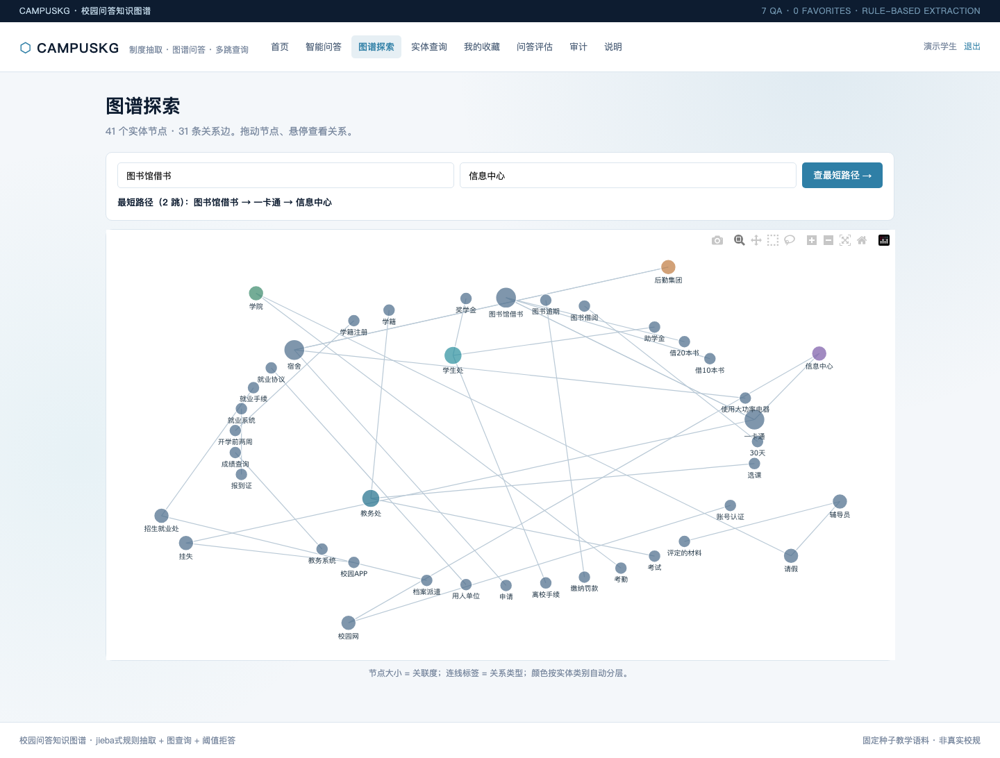
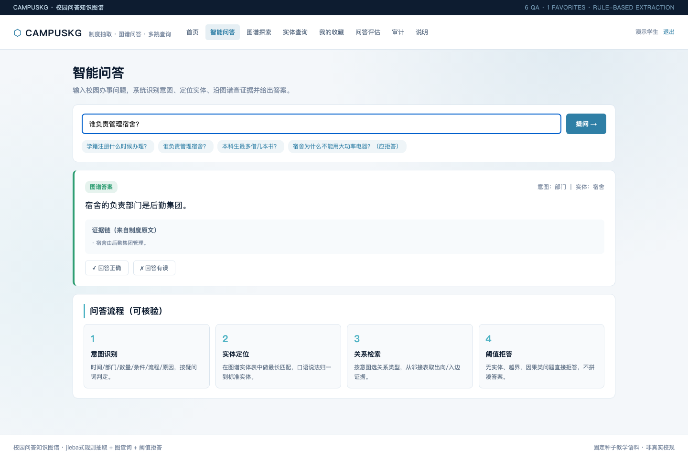
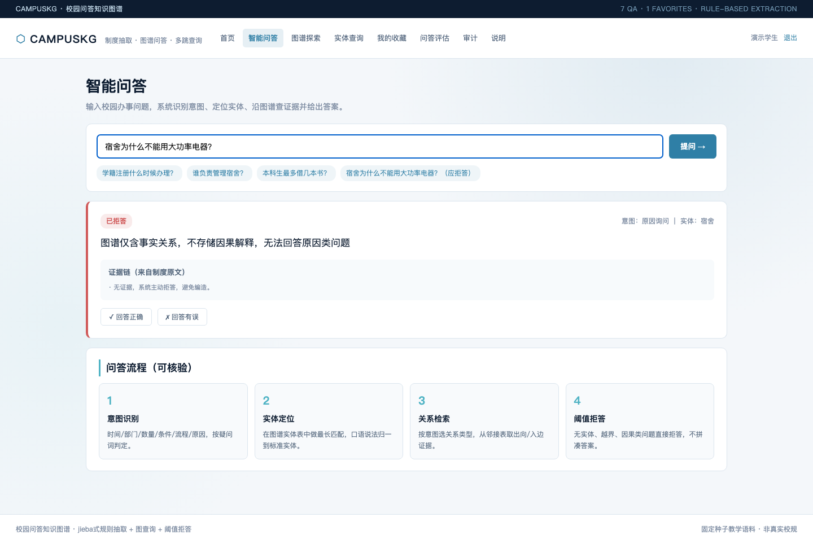
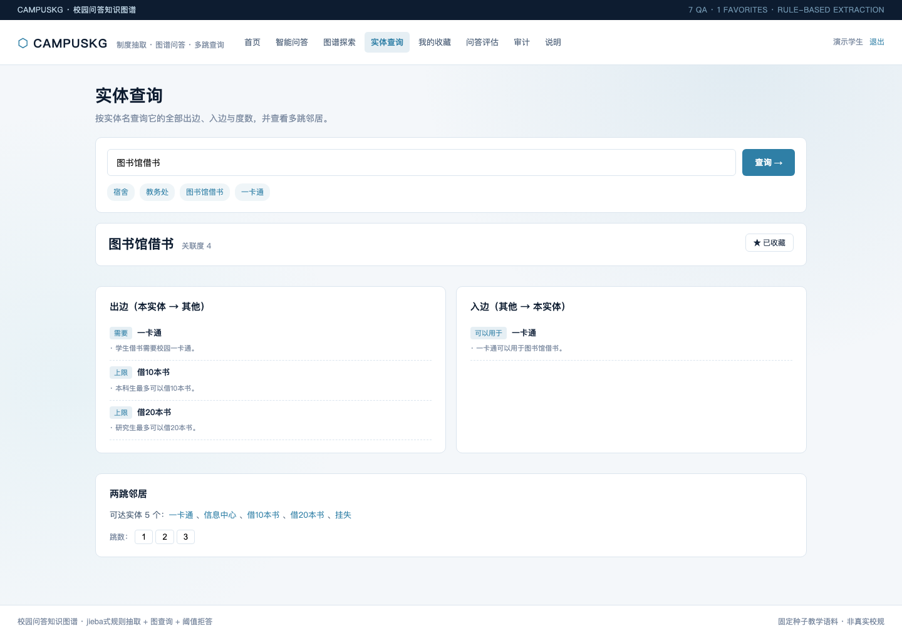
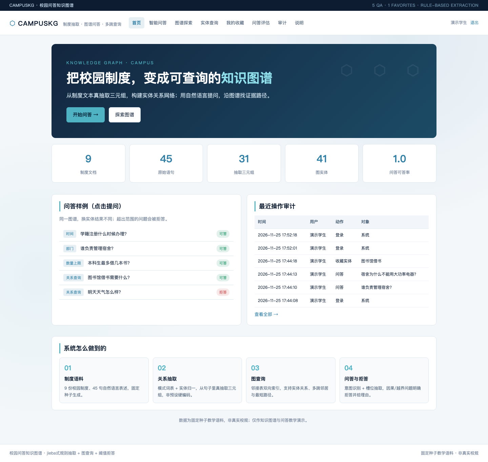
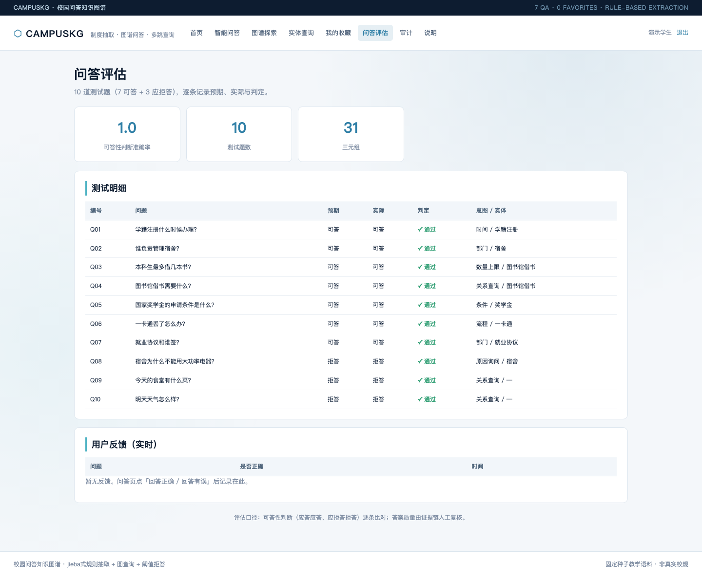

# 092 基于Django的校园问答知识图谱系统-设计展示

> **代码有偿获取 可接受定制 微信联系方式: csbysj2020 或 ACE2487，备注(BS)**

> **完整源码与全套文档 · 在线自助获取 >>> [https://mbd.pub/o/bread/YZaWmZlqaw==](https://mbd.pub/o/bread/YZaWmZlqaw==)**

> **成品页（功能介绍 / 更多选题）>>> [https://bishe.suilang.net/products/campuskg](https://bishe.suilang.net/products/campuskg)**

> 

> 

## 视频

> **点击查看 >>> [https://www.bilibili.com/video/BV12myzzUEAF/](https://www.bilibili.com/video/BV12myzzUEAF/)**

## 项目简介

墨蓝知识网络视觉，区别于所有桌面端成品。从 9 份校园制度文档（45 句）用模式词表真抽取 31 条三元组、41 个实体；邻接表双向索引支持出/入边、1-3 跳邻居与 BFS 最短路径（实测 图书馆借书→一卡通→信息中心 2 跳）；自然语言问答含意图识别与阈值拒答，答案附制度原文证据链，10 题可答性判断准确率 1.0。Django+SQLite+Plotly，10 页面。固定种子教学语料，非真实校规。

校园制度文本分散、责任部门难定位，学生办事检索成本高。

本项目设计并实现一套校园问答知识图谱系统：以固定种子生成的 9 份校园制度文档（45 句表述）为语料，采用模式词表与实体别名归一从文本中真抽取三元组，构建 31 条关系、41 个实体的知识图谱；以邻接表双向索引支持实体出/入边查询、1—3 跳邻居扩展与 BFS 最短路径；以意图识别与槽位抽取实现自然语言问答，并对无实体、越界领域与因果类问题主动拒答，答案均附制度原文证据链。

系统采用 Django + SQLite + Plotly.js 实现，含问答、图谱探索、实体查询、收藏、反馈与审计等功能。

本仓库为**设计展示**：包含项目说明、技术架构、实验结果与运行截图；完整源码、任务书、开题报告、毕业论文与使用说明可通过上方链接自助获取，成品页可查看更多选题，也可联系微信咨询定制。

## 功能特性

1. 真关系抽取：9 条有序正则模式 + 别名归一 + 停用词，从 45 句制度文本真抽取 31 三元组、41 实体（非预设硬编码）

2. 图查询：邻接表双向索引，实体出/入边、1-3 跳邻居扩展、BFS 最短路径

3. 自然语言问答：意图识别（时间/部门/数量/条件/流程/原因）+ 最长实体匹配 + 答案生成

4. 阈值拒答：无实体/越界领域/因果类问题明确拒绝并给理由，不编造答案

5. 证据链：每条答案附制度原文证据，可逐条人工复核

6. 可视化：Plotly.js 渲染 41 节点关系网络，支持最短路径交互查询

7. 完整闭环：问答历史、实体收藏、正确性反馈、操作审计全部写库

## 技术架构

| 项目 | 说明 |
| --- | --- |
| 编程语言 | Python 3.8+ |
| Web 框架 | Django 4 + Jinja2 |
| 核心引擎 | analytics/kg.py（抽取+图+问答） |
| 数据库 | SQLite（5表） |
| 可视化 | Plotly.js |
| 端口 | http://127.0.0.1:8092 |
| 演示账号 | user/user123、admin/admin123 |

## 目录结构

以下为完整交付版的结构（本仓库仅作设计展示）：

```
campuskg/
├── analytics/
│   └── kg.py
├── data/
│   ├── analysis/
│   │   ├── entities.json
│   │   ├── qa_demos.json
│   │   ├── qa_eval.json
│   │   └── triples.json
│   ├── processed/
│   │   ├── documents.csv
│   │   └── questions.csv
│   ├── campus_kg.db
│   └── stats.json
├── kgproj/
│   ├── __init__.py
│   ├── settings.py
│   ├── urls.py
│   └── wsgi.py
├── kgweb/
│   ├── __init__.py
│   ├── db.py
│   └── views.py
├── static/
│   ├── css/
│   │   └── style.css
│   └── vendor/
│       └── plotly.min.js
├── templates/
│   ├── about.html
│   ├── audit.html
│   ├── base.html
│   ├── entity.html
│   ├── evaluation.html
│   ├── favorites.html
│   ├── graph.html
│   ├── login.html
│   ├── overview.html
│   └── qa.html
├── 任务书/
│   └── 毕业设计任务书.docx
├── 开题报告/
│   └── 毕业设计开题报告.docx
└── …
```

## 数据与实验结论

- 10 道测试题（7 可答 + 3 应拒答）的可答性判断准确率为 1.0。
- 真关系抽取：9 条有序正则模式 + 别名归一 + 停用词，从 45 句制度文本真抽取 31 三元组、41 实体（非预设硬编码）
- 图查询：邻接表双向索引，实体出/入边、1-3 跳邻居扩展、BFS 最短路径
- 可视化：Plotly.js 渲染 41 节点关系网络，支持最短路径交互查询

## 交付内容

1. 完整源码（抽取引擎+图查询+Django+SQLite）
2. 真实数据（9文档/45句/31三元组/41实体/10测试题）
3. 任务书与开题报告（Word）
4. 毕业论文（Word七章制）
5. 二次开发说明（Word+md）
6. 10张桌面截图+封面+101s视频

## 常见问题

**三元组是写死的吗？**

不是，由 kg.py 从 45 句制度文本按模式词表真抽取，改语料重跑即变化。

**为什么有些问题不回答？**

图谱只存事实关系，因果类、越界类、无实体问题会明确拒答并给理由，避免编造。

**数据是真实校规吗？**

固定种子 20231124 生成的教学语料，非任何学校的真实校规。

**能查多跳关系吗？**

可以，实体页支持 1-3 跳邻居，图谱页输入起点终点返回 BFS 最短路径。

## 截图







